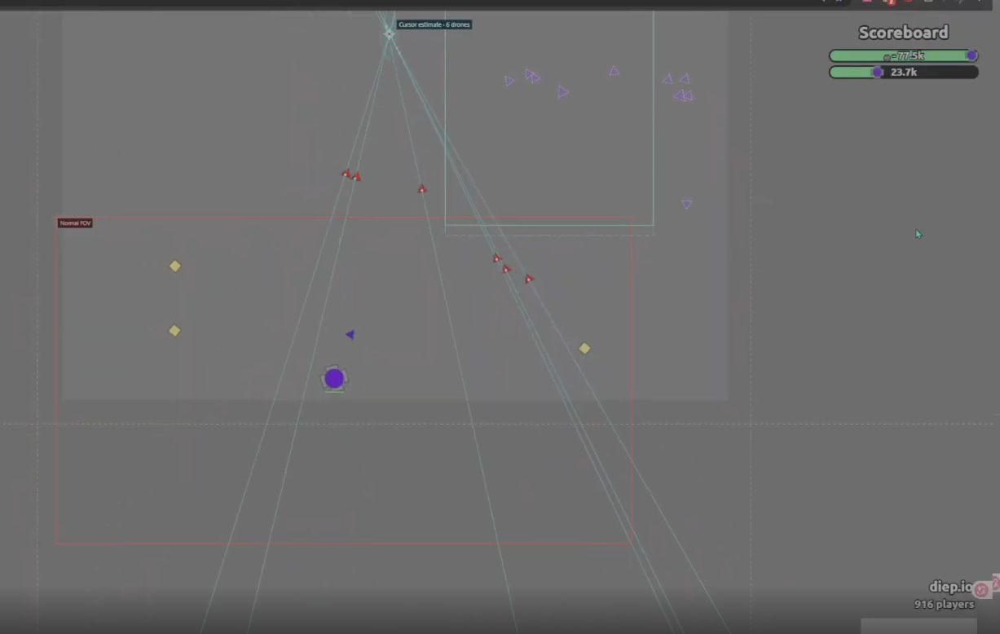
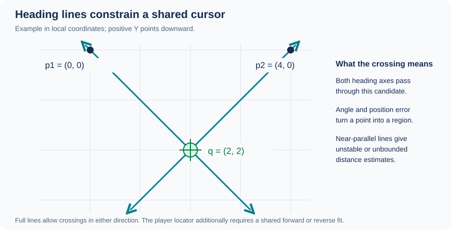
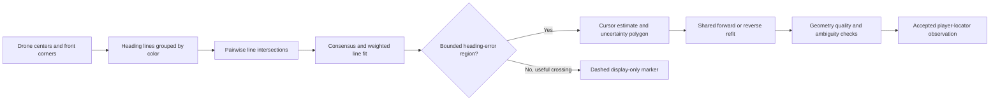
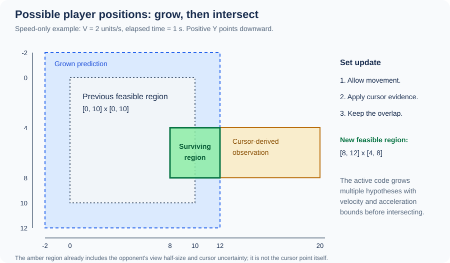
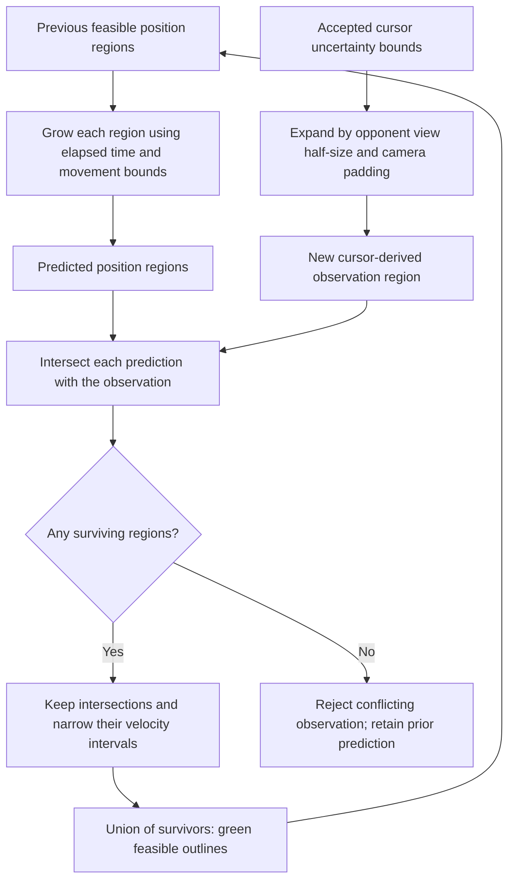
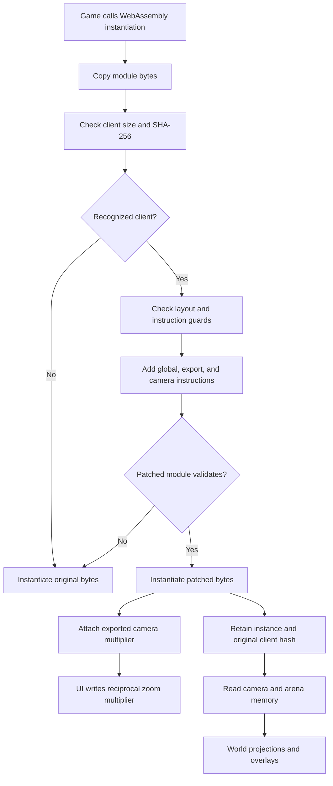

# Diep.io FOV Script

A Tampermonkey userscript for [Diep.io](https://diep.io/) with adjustable camera zoom, a normal-FOV reference box, and experimental drone visualizations.

Youtube Video Demonstration: https://youtu.be/yhBnKF3lCHo

## Preview



In-game view with the red normal-FOV reference, cyan cursor-estimation lines, green predicted player location and purple predicted drone shadows.

## Features

- **Camera zoom:** adjust visible width from **0.10× to 3.00×** the normal camera.
- **Normal-FOV outline:** a red box marks the normal camera view.
- **Drone cursor estimates:** cyan lines through visible drone headings estimate where a cursor may be.
- **Drone shadows:** purple markers predict selected drones' movement after they leave the normal view, using momentum, drag, and your controls.
- **Player locator:** estimates possible positions for one opponent from inferred cursor observations and movement constraints.
- **Saved preferences:** zoom level and overlay settings are stored in the site's local storage. Camera zoom starts disabled after every reload.

## Installation

1. Install [Tampermonkey](https://www.tampermonkey.net/) in your browser.
2. Open [script.js](./script.js), then select **Raw** and copy the complete file.
3. Open the Tampermonkey dashboard and create a new script.
4. Replace the template with the copied code, save it, and make sure the script is enabled.
5. Open or reload [Diep.io](https://diep.io/). The **FOV editor** panel appears in the top-right corner.

The userscript is currently named **1v1** in its metadata, so that is the name shown in Tampermonkey. It matches both `https://diep.io/*` and `https://www.diep.io/*` and runs at `document-start`.

No build step or package installation is required.

## Camera controls

Wait for the panel to show **Ready**, then press **J** or click **Enable** to activate zoom.

| Control | Action |
| --- | --- |
| **J** | Toggle camera zoom; disabling restores normal zoom |
| **Mouse wheel down** | Increase visible width / zoom out |
| **Mouse wheel up** | Decrease visible width / zoom in |
| **Shift + mouse wheel** | Also adjust zoom |
| **+ / −** buttons | Increase / decrease visible width |
| **Reset 1×** | Set the multiplier to normal camera width |
| **Alt + H** | Hide or show the panel |
| **Alt + C** | Toggle drone cursor rays |

A multiplier above **1×** shows a wider view; below **1×** shows a closer view. Wheel adjustments apply only while camera zoom is enabled. Keyboard shortcuts are ignored while typing in inputs or using modal dialogs.

Hiding the panel leaves active features running. To stop the entire userscript, disable it in Tampermonkey and reload the page.

## Drone visualizations

### Cursor rays

Expand **Drone cursor settings** to show all detected drone colors or select one color. Use **Front corner** to choose which triangle corner represents the drone's heading; check it against your own drones while aiming steadily.

Cyan lines extend through each drone's center and front corner in both directions. Their intersections estimate a cursor for each detected group. A dashed marker means the crossing distance is still uncertain; estimates based on two drones are tentative.

### Drone shadows

1. Expand **Drone shadow settings**.
2. Click **Pick my drones**, then click one of your visible drones. You can also select a color or enter a hex code.
3. Zoom out above **1×** to see predicted shadows beyond the normal-FOV box.
4. Adjust **Keep shadows for** as needed; the default is **15 seconds**.

The predictor reads the game's saved custom bindings. With default bindings, left mouse / **Space** attracts, right mouse / **Shift** repels, and **E** toggles auto-fire. The prediction target stays inside the red normal-FOV box; actual game aiming is unchanged.

Arena movement limits are estimated automatically and shown with amber dashes. Shared team colors may cause teammates' drones to be included.

### Player locator

Expand **Player locator settings** and use **Pick opponent drones** to select one opponent's drone color, or turn on **Player locator** to use automatic color selection. The locator starts off by default. Automatic selection skips your selected shadow color and pauses observations when multiple matching cursor estimates are ambiguous.

- **Green outlines:** possible current positions.
- **Blue dotted outlines:** predicted possible positions.
- **Dashed outer boxes:** bounds around those regions, rather than an exact location.

The locator assumes the inferred cursor remains inside the opponent's normal view. Its default opponent view follows a **1920×1080 level-45 Overlord** view; adjust the view dimensions and movement settings when those assumptions differ. Use **Reset history** to clear accumulated observations.

## Mathematics

The equations below describe the implementation in [script.js](./script.js). Coordinates are two-dimensional; screen Y increases downward. Cursor fitting uses canvas-local **CSS pixels**, while shadow prediction and player location use **world units**.

GitHub supports [LaTeX math](https://docs.github.com/en/get-started/writing-on-github/working-with-advanced-formatting/writing-mathematical-expressions) and [Mermaid diagrams](https://docs.github.com/en/get-started/writing-on-github/working-with-advanced-formatting/creating-diagrams). TikZ is not rendered directly in a GitHub README, so the diagrams here use Mermaid.

### Camera zoom and coordinate conversion

Let $m$ be the selected view-width multiplier, $s_0$ the normal camera scale, and $s$ the active scale in canvas backing pixels per world unit. The added WebAssembly global holds $g$:

```math
g=\begin{cases}1/m & \text{zoom enabled},\\1 & \text{zoom disabled},\end{cases}
\qquad s=g\,s_0,\qquad 0.1\le m\le3.
```

For camera center $(c_x,c_y)$ and backing-canvas size $W_b\times H_b$, a world point $(x,y)$ projects to:

```math
u_b=\frac{W_b}{2}+(x-c_x)s,\qquad
v_b=\frac{H_b}{2}+(y-c_y)s.
```

If the canvas occupies $W_c\times H_c$ CSS pixels, then $u_c=u_bW_c/W_b$ and $v_c=v_bH_c/H_b$. The inverse projection is:

```math
x=c_x+\frac{(u_c-W_c/2)W_b}{sW_c},\qquad
y=c_y+\frac{(v_c-H_c/2)H_b}{sH_c}.
```

Subtract the canvas element's page position before using page-pointer coordinates. The decoded memory scale already includes zoom, so it must not be multiplied by $g$ again.

When enabled, the red normal-view rectangle is centered on the canvas and measures $W_c/m$ by $H_c/m$ in CSS pixels. Its world width and height are $W_b/(sm)$ and $H_b/(sm)$. At $m=2$, the normal view occupies half the displayed width and height.

### Drone heading lines and cursor intersections

For a captured triangle with vertices $\mathbf a_i,\mathbf b_i,\mathbf c_i$, its center and selected front-corner direction are:

```math
\mathbf p_i=\frac{\mathbf a_i+\mathbf b_i+\mathbf c_i}{3},\qquad
\mathbf d_i=\frac{\mathbf f_i-\mathbf p_i}
{\|\mathbf f_i-\mathbf p_i\|}.
```

The visible cursor overlay treats each heading as a **full line**:

```math
L_i=\{\mathbf p_i+t\mathbf d_i:t\in\mathbb R\}.
```

Allowing negative $t$ lets a crossing lie behind a drone, as can happen during repel. These drawn "rays" are therefore bidirectional axes.

Define the 2D cross product by $\mathbf a\times\mathbf b=a_xb_y-a_yb_x$. Two lines intersect at:

```math
D=\mathbf d_i\times\mathbf d_j,\qquad
t=\frac{(\mathbf p_j-\mathbf p_i)\times\mathbf d_j}{D},\qquad
\mathbf q=\mathbf p_i+t\mathbf d_i.
```

Small $|D|$ means nearly parallel headings: tiny angle errors can move the intersection a long distance. The code rejects numerical degeneracy and limits candidate distance to four viewport diagonals from the viewport center.

For example, $\mathbf p_1=(0,0)$, $\mathbf d_1=(1,1)/\sqrt2$ and $\mathbf p_2=(4,0)$, $\mathbf d_2=(-1,1)/\sqrt2$ intersect at $(2,2)$.





#### More than two drones: fitting a common crossing

Let $\mathbf n_i=(-d_{iy},d_{ix})$ be a unit normal to heading $i$. A common point approximately satisfies $\mathbf n_i^\mathsf T(\mathbf q-\mathbf p_i)=0$. The weighted least-squares fit solves:

```math
\widehat{\mathbf q}
=\underset{\mathbf q}{\mathrm{arg\,min}}
\sum_i w_i\left[\mathbf n_i^\mathsf T(\mathbf q-\mathbf p_i)\right]^2,
```

```math
A=\sum_iw_i\mathbf n_i\mathbf n_i^\mathsf T,\qquad
\mathbf b=\sum_iw_i\mathbf n_i\mathbf n_i^\mathsf T\mathbf p_i,
\qquad A\widehat{\mathbf q}=\mathbf b.
```

The implementation normalizes weights by their maximum; this does not change the minimizer. The eigenvalue ratio $\lambda_{\min}(A)/\lambda_{\max}(A)$ measures how well the headings constrain a crossing. A small ratio signals poor geometry.

A fitted point alone is insufficient. The implementation also intersects heading-error cones, requires a bounded feasible polygon, and checks consensus. If the least-squares point is outside that polygon, it uses the average of the polygon's vertices.

#### Heading error and the uncertainty polygon

For one direction-oriented ray, let $\varepsilon$ be its position-error bound, $\theta$ its angle-error bound, $\tau=\tan\theta$, and $\mathbf r=\mathbf q-\mathbf p_i$. Its three half-plane constraints are:

```math
(\mathbf n_i-\tau\mathbf d_i)^\mathsf T\mathbf r
 \le \varepsilon\sqrt{1+\tau^2},
\qquad
(-\mathbf n_i-\tau\mathbf d_i)^\mathsf T\mathbf r
 \le \varepsilon\sqrt{1+\tau^2},
\qquad
-\mathbf d_i^\mathsf T\mathbf r\le\varepsilon.
```

Intersecting these half-planes for the accepted drones gives a cursor uncertainty polygon. These are geometric bounds conditional on the chosen error limits, rather than statistical confidence levels. The live analysis defaults to $\varepsilon=2$ CSS pixels and $\theta=3^\circ$.

For the cursor display, each line can be oriented toward a candidate independently. The **player locator is stricter**: it refits all contributing drones with one shared forward orientation or one shared reverse orientation. It also checks at least three inliers, angular spread, conditioning, cursor distance relative to the drone baseline, uncertainty size, and residual error. A plausible drawn crossing can therefore be excluded from player-location updates.

### Player location: grow, then intersect

The locator estimates a **set of possible tank/camera centers**, conditional on the cursor staying inside the opponent's normal view.

Let the accepted cursor uncertainty bounds at time $k$ be:

```math
Q_k=[q_x^-,q_x^+]\times[q_y^-,q_y^+].
```

If the opponent's normal-view half-width and half-height are $h_x,h_y$, and camera padding is $p$, the cursor-derived observation region is:

```math
O_k=Q_k\oplus
\bigl([-h_x-p,h_x+p]\times[-h_y-p,h_y+p]\bigr).
```

Here $\oplus$ means the **Minkowski sum**: add every point in one set to every point in the other. Explicitly:

```math
O_k=
[q_x^- -h_x-p,\ q_x^+ +h_x+p]
\times
[q_y^- -h_y-p,\ q_y^+ +h_y+p].
```

This is why a cursor crossing does not identify a tank location: many view centers could contain that cursor. The code uses the polygon's bounding rectangle for this step, which adds some looseness.

#### The basic growing-region intersection

With only a speed bound $V$ and elapsed time $\Delta t$, a conservative positional update is:

```math
P_k=F_{k-1}\oplus[-V\Delta t,V\Delta t]^2,\qquad
F_k=P_k\cap O_k.
```

$F_{k-1}$ is the previous feasible position set; $P_k$ is the region after allowing movement; $O_k$ is what the new cursor observation permits. This square expansion bounds movement along each axis. For a circular speed limit its corners overestimate reach.

For rectangles $P=[a_x,b_x]\times[a_y,b_y]$ and $O=[c_x,d_x]\times[c_y,d_y]$, the intersection is:

```math
P\cap O=
[\max(a_x,c_x),\min(b_x,d_x)]
\times
[\max(a_y,c_y),\min(b_y,d_y)].
```

An intersection is empty if either lower endpoint exceeds its upper endpoint.

For example, take $F_{k-1}=[0,10]\times[0,10]$, $V=2$, and $\Delta t=1$. Then $P_k=[-2,12]\times[-2,12]$. A new cursor-derived region $O_k=[8,20]\times[4,8]$ narrows the result to $F_k=[8,12]\times[4,8]$.





The speed-only equation explains the grow/intersect idea. The active locator uses the following more detailed position-and-velocity model.

#### What the active implementation keeps

Each hypothesis stores a position rectangle $B_j$ and separate velocity intervals $I_{x,j},I_{y,j}$. The feasible position set is the union:

```math
F_k=\bigcup_j B_{j,k}.
```

Keeping multiple hypotheses preserves relationships such as "left-side position implies rightward motion" better than merging everything into one large box. The code starts with position and velocity subdivisions and refines survivors up to **384 hypotheses**. Rectangular intervals still approximate the true feasible trajectories.

For one axis with maximum acceleration $a$ and maximum speed $V$, a velocity interval $[v^-,v^+]$ first expands to:

```math
[v^-,v^+]\longmapsto
[\max(-V,v^- -a\Delta t),\ \min(V,v^+ +a\Delta t)].
```

Position growth integrates acceleration only until the speed cap is reached. For $a>0$, define $T=\min(\Delta t,(V-v_0)/a)$ for a starting velocity $v_0$ already clamped to $[-V,V]$. The maximum displacement is:

```math
d_{\max}(v_0,\Delta t)=v_0T+\frac12aT^2+V(\Delta t-T),
\qquad
d_{\min}(v_0,\Delta t)=-d_{\max}(-v_0,\Delta t).
```

When $a=0$, both displacements are $v_0\Delta t$. A hypothesis's predicted X interval is:

```math
[x^-,x^+]\longmapsto
[x^-+d_{\min}(v^-,\Delta t),\
 x^++d_{\max}(v^+,\Delta t)].
```

Y uses the same calculation. Speed and acceleration are bounded **per axis** in this implementation, so diagonal reach can be looser than a circular vector-speed bound.

Each predicted rectangle is intersected with $O_k$. For elapsed times of at least **15 ms**, surviving intersections also narrow velocity. If the old X interval is $[x^-,x^+]$ and its new overlap is $[z^-,z^+]$, the possible average X velocity is:

```math
\overline I_x=
\left[\frac{z^- -x^+}{\Delta t},\
      \frac{z^+ -x^-}{\Delta t}\right].
```

The code expands that interval by $\pm a\Delta t$, clips it to $[-V,V]$, and intersects it with the predicted velocity interval when that intersection is valid.

If **all** hypotheses conflict with a new observation, the observation is rejected and the prior prediction is retained. A bad reading therefore does not immediately erase the trajectory set. Predictions expire without a usable observation; the default expiry is **7 seconds**. Defaults are $V=532$ world units/s and $a=1000$ world units/s² per axis. The green outlines show the surviving position regions, blue dotted outlines show predictions, and dashed hull boxes are only enclosing guides.

### Drone-shadow motion

Visible displacements estimate velocity:

```math
\widehat{\mathbf v}_k=
\frac{\mathbf x_k-\mathbf x_{k-1}}{t_k-t_{k-1}}.
```

The tracker uses component-wise medians of up to five recent velocity samples to suppress spikes. Returning observations establish a fresh baseline instead of treating a long hidden interval as an instantaneous velocity measurement.

During attract or repel, let $\mathbf u$ be the clamped world-pointer target, $v_c$ the estimated cruise speed, and $\sigma=+1$ for attract or $-1$ for repel:

```math
\mathbf v_*=\sigma v_c\frac{\mathbf u-\mathbf x}{\|\mathbf u-\mathbf x\|},
\qquad
\lambda=-\frac{\ln(0.9)}{0.04}\approx2.634\ \mathrm{s}^{-1}.
```

For a substep $h$ with fixed target velocity, the update integrates $\dot{\mathbf v}=\lambda(\mathbf v_*-\mathbf v)$ exactly:

```math
r=1-e^{-\lambda h},\qquad
\mathbf v'=\mathbf v+r(\mathbf v_*-\mathbf v),
\qquad
\mathbf x'=\mathbf x+\mathbf v_*h+
\frac{r}{\lambda}(\mathbf v-\mathbf v_*).
```

The script recomputes the target direction in substeps no longer than **10 ms**. At zero target distance, target velocity is zero. Without reliable steering it coasts with $\mathbf x'=\mathbf x+\mathbf v h$ and unchanged velocity. Arena limits clamp positions while preserving momentum.

This is an approximate predictor, not a recovered copy of the server simulation. Shadows require a previously observed drone, measured velocity, and evidence of leaving the normal viewport. An unexplained disappearance in its interior does not establish an offscreen track.

## WebAssembly and memory hooks

### What WebAssembly contributes

WebAssembly (Wasm) is binary executable code instantiated by the browser. A module can export functions, mutable globals, and linear memory to JavaScript. This script intercepts the game's module instantiation, adds a camera-control global to a recognized binary, and retains the resulting instance for camera reads.

Two different operations are involved:

| Operation | Purpose | Data changed |
| --- | --- | --- |
| Binary patch before instantiation | Add a camera multiplier at verified instruction sites | A copied Wasm binary |
| Runtime camera control | Select the scale used by the patched camera code | The added mutable Wasm global |
| Camera/arena memory reads | Convert between screen and world coordinates and estimate arena limits | Read-only access to the game's linear memory |
| Canvas observation hooks | Recover visible drone triangle geometry and colors | Local observation records; original draw calls receive their original arguments |

### Intercepting module loading

The userscript runs at `document-start` in the page context. `DiepFovLoader.install()` wraps `WebAssembly.instantiate` and `WebAssembly.instantiateStreaming` while retaining the original functions.

For byte inputs, the wrapper copies the original bytes and gives the preparer a separate copy. For an eligible streaming response, it reads a cloned response into bytes before using the byte-based instantiation path. Already compiled `WebAssembly.Module` inputs keep their native handling and cannot be rewritten by this byte patcher.



The boot code skips preparation for modules smaller than **1,000,000 bytes**. For larger modules, `prepareWasm()` selects a profile by exact byte length and SHA-256 of the **original** binary. `patchWasm()` then checks import/function/global counts, function body sizes, nearby instruction bytes, and original module validity.

The code contains these two profiles; `CURRENT_PROFILE` is a source-code label, not a guarantee that today's live game still matches it.

| Profile | Original bytes | Camera function index | Insertion offsets within that function body |
| --- | ---: | ---: | --- |
| `CURRENT_PROFILE` | 5,982,383 | 2030 | 17809, 67091 |
| `PROFILE` | 5,972,989 | 1588 | 21172, 68993 |

Original client SHA-256 fingerprints:

```text
CURRENT_PROFILE  d95b0afa7892bb9581b96939a41a7e22cc0e7a40c8b2c70d4faede66d3183126
PROFILE          7ac1a1659ee8514ded697b39a218811d6c7318f6f6ffa12b5fe1763633610668
```

### The camera bytecode patch

The patch adds one **mutable `f32` global**, initialized to `1.0`, and exports it as `__diepFovMultiplier`. At each of two verified camera sites it inserts the equivalent of:

```wat
;; Schematic insertion: an existing camera-scale f32 is already on the stack.
global.get <new-global-index>
f32.mul
```

`global.get` pushes the multiplier and `f32.mul` multiplies it by the existing scale. The patch rebuilds the global, export, and code sections, updating vector counts and LEB128-encoded section/function lengths, then checks `WebAssembly.validate` again.

After instantiation, `onInstance` finds `instance.exports.__diepFovMultiplier`. The controller assigns its `.value` to `1 / multiplier` while enabled and `1` while disabled. This mutable global is separate from the linear-memory byte offsets used below.

If preparation is unsupported or fails, the loader keeps the original bytes. If changed bytes cause a `WebAssembly.CompileError`, it retries the original binary. It does **not** retry link or runtime failures, which may already have produced side effects. Destroying the editor restores its wrappers where still installed and resets zoom; a reload is needed to instantiate the original unpatched module again.

### Reading camera data from linear memory

`DiepShadowCamera.readCamera(instance, sha256)` selects a layout and decoder only for a known original client hash. It obtains `instance.exports.da`, checks that it is a `WebAssembly.Memory`, and creates a `DataView` over its current `memory.buffer`.

The addresses below are **byte offsets into that instance's linear memory**, not JavaScript object addresses or offsets in the Wasm file.

| Profile | Encoded camera X | Encoded camera Y | Encoded camera scale | Plain arena edges: left, top, right, bottom |
| --- | ---: | ---: | ---: | --- |
| `CURRENT_PROFILE` | 603724 | 603756 | 603732 | 569996, 570000, 570004, 570008 |
| `PROFILE` | 492396 | 492428 | 492404 | 515420, 515424, 515428, 515432 |

Camera fields are loaded using little-endian `getUint32(offset, true)` and decoded before being interpreted as IEEE-754 `f32` values. Arena edges use little-endian `getFloat32(offset, true)` directly.

For the current profile, let $e_0,e_1,e_2,e_3$ be the stored word's bytes from least to most significant. The decoder computes:

```math
\begin{aligned}
b_0&=(e_0+81)\bmod256,\\
b_1&=(e_3+131e_0+227)\bmod256,\\
b_2&=(e_2+42e_3+107)\bmod256,\\
b_3&=(e_1+95e_2-11)\bmod256,\\
z&=(b_0+2^8b_1+2^{16}b_2+2^{24}b_3)
 \mathbin{\mathrm{XOR}}\mathtt{0x964c929b}.
\end{aligned}
```

The 32 bits of $z$ are **reinterpreted** as a float; converting its integer magnitude to a float would give a different result. The older profile has a different byte decoder in `decode()`.

The reader rejects truncated memory, nonfinite coordinates, absolute camera positions above $10^7$, and scales outside $[10^{-4},100]$. Arena bounds receive separate size and plausibility checks. It reacquires `memory.buffer` on every read because [memory growth can invalidate an existing buffer/view](https://developer.mozilla.org/en-US/docs/WebAssembly/Reference/JavaScript_interface/Memory/grow).

These reads provide the **local camera and arena geometry**. Opponent positions are inferred from rendered drone headings and the growing-region model above; the locator does not read an opponent-coordinate field from memory.

### Observing the canvas

`DroneCapture` wraps selected `CanvasRenderingContext2D.prototype` methods, including path construction and fill calls. It applies `getTransform()` to captured path points, collapses collinear edge points, identifies near-equilateral triangles, and records their centers, vertices, and fill colors. It observes only the selected game canvas and calls the original rendering methods with the original arguments.

This is how the script obtains drone observations without reading an entity list from Wasm memory. Opaque `Path2D` objects are skipped because these hooks cannot inspect their geometry. Rendering changes can therefore break observations even when the camera profile still matches.

Further background: [MDN's WebAssembly JavaScript API guide](https://developer.mozilla.org/en-US/docs/WebAssembly/Guides/Using_the_JavaScript_API).

## Compatibility and limitations

Camera patching requires a supported Diep.io WebAssembly build. The script verifies the binary's size and SHA-256 fingerprint, checks camera instruction guards, and validates the patched module before using it.

If the panel reports **Unsupported**, the game client needs an updated camera profile. The loader falls back to the original game bytes when patching is unavailable. A game update can therefore disable camera zoom until the script is updated.

Drone overlays depend on visible rendered drones and usable camera data. Cursor intersections, shadows, arena limits, and player regions are estimates; they do not provide authoritative hidden positions. Weak or ambiguous cursor geometry can prevent locator updates.

## Troubleshooting

| Problem | What to try |
| --- | --- |
| No panel | Confirm Tampermonkey and **1v1** are enabled, check that you are on Diep.io, then reload |
| Panel stays on **Waiting** | Reload with the userscript already enabled so it can intercept the game's WebAssembly loading |
| **Unsupported** client | Check for a script update containing a matching camera profile |
| Wheel does nothing | Enable camera zoom first and move the pointer outside the panel or editable fields |
| Panel disappeared | Press **Alt + H** outside an input field |
| No cursor rays | Enable **Cursor rays**, keep drones visible, and check the color filter and front-corner setting |
| No drone shadows | Select your drone color and zoom out above **1×** |
| Locator is empty or inconsistent | Select one opponent, check the view/movement assumptions, and reset history |

To update manually, replace the installed userscript with the latest contents of [script.js](./script.js), save, and reload Diep.io.

## Repository

- [script.js](./script.js) — complete userscript, including camera patching, controls, and overlays.
- [Issues](https://github.com/kzy09c/diep-fov-script/issues) — report problems with the panel status, reproduction steps, browser, and installed script version.

## License

This repository currently has no standalone license file. Some embedded sections carry MIT SPDX notices; see [script.js](./script.js) for those notices.
